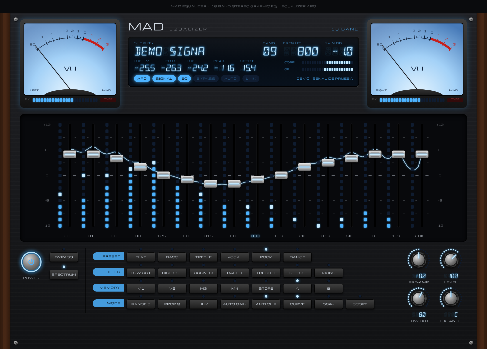

# MAD Equalizer

A vintage 16-band stereo graphic equalizer for **all** of your computer's audio, with blue LED spectrum analyzer, 14-segment displays and analog VU meters. Available for **macOS** and **Windows**.

*Ecualizador gráfico estéreo vintage de 16 bandas para **todo** el audio del equipo, con analizador de espectro de LEDs azules, displays de 14 segmentos y medidores VU analógicos. Disponible para **macOS** y **Windows**. [Versión en español más abajo](#español).*



**[Download the latest release](https://github.com/madkoding/mad-equalizer/releases/latest)** (`.dmg` for macOS, `.zip` with the installer for Windows) · **[Website](https://madkoding.github.io/mad-equalizer/)**

## Features

- 16 ISO bands (20 Hz – 20 kHz), ±12 dB or ±6 dB range, constant or proportional Q
- Real-time spectrum analyzer on the fader LEDs, and the real summed response curve
- VU meters with peak/OVER, LUFS (momentary, short-term, integrated), peak hold, crest factor, phase correlation and goniometer
- Presets, 4 memories, A/B comparison, auto-gain and independent L/R editing
- **50%** key (MODE row) to shrink the whole window to half size; the choice is remembered
- Low cut, high cut, loudness, bass/treble boost, de-esser and mono filters

## How it works

| | macOS (`macos/`) | Windows (`windows/`) |
|---|---|---|
| Audio engine | Core Audio **process tap** (macOS 14.4+): captures and mutes system audio, then plays it processed on the real output device through a private aggregate device. No drivers. | **[Equalizer APO](https://sourceforge.net/projects/equalizerapo/)** does the system-wide processing; MAD writes its configuration (`MAD.txt`) and reads a loopback copy of the output for the meters. |
| UI | SwiftUI (Swift, no Xcode project needed) | Electron + Canvas |
| Extra | Peak limiter, per-app exclusion | Anti-clip, balance |
| Package | `.dmg` (universal: Apple Silicon + Intel) | NSIS installer that bundles Equalizer APO |

If the macOS app quits or crashes, the system removes the tap and audio returns to normal automatically.

## Building

### macOS

Requires macOS 14.4+ and the Xcode command line tools (`xcode-select --install`).

```bash
cd macos
./build.sh       # → MAD Equalizer.app (universal)
./make_dmg.sh    # → MAD-Equalizer-2.0.dmg
```

`tools/Artwork.swift` regenerates the icon and the DMG background (`art/`).

### Windows

Builds from macOS or Linux. Requires Node.js and NSIS (`brew install makensis`).

```bash
cd windows
npm install
# Official Electron runtime for Windows (verify it against SHASUMS256.txt of the same release)
mkdir -p .cache && curl -L -o .cache/electron-v42.11.16-win32-x64.zip \
  https://github.com/electron/electron/releases/download/v42.11.16/electron-v42.11.16-win32-x64.zip
# Official Equalizer APO installer (bundled into the setup)
mkdir -p vendor && curl -L -o vendor/EqualizerAPO-x64-1.4.2.exe \
  https://sourceforge.net/projects/equalizerapo/files/1.4.2/EqualizerAPO-x64-1.4.2.exe/download
./build.sh       # → out/MAD-Equalizer-2.0-Windows.zip (setup + README/LEEME)
```

`npm run demo` runs the UI in **demo mode** on any OS (test signal, configuration written to a local folder), handy for working on the interface without Windows.

## Unsigned builds

Neither build is signed or notarized. On macOS, if the app won't open:

```bash
xattr -dr com.apple.quarantine "/Applications/MAD Equalizer.app"
```

On Windows, SmartScreen shows "Windows protected your PC": click **More info → Run anyway**. Details are in each platform's `README.txt` / `LEEME.txt`.

## License

MIT, see [`LICENSE`](LICENSE). Third-party components keep their own licenses (below).

## Third-party components

- **Michroma** font, © The Michroma Project Authors, and **DSEG** font, © keshikan: SIL Open Font License 1.1 (`licenses/`).
- **Equalizer APO** (Windows installer only), © Jonas Thedering: GPL v2. Not included in this repository; the build downloads the official installer. See `windows/installer/THIRD-PARTY-NOTICES.txt`.
- **Electron**: MIT.

---

## Español

**MAD Equalizer** ecualiza todo lo que suena en el equipo con la estética de un equipo de audio de los 80.

- **macOS:** usa un *tap* de Core Audio (macOS 14.4 o posterior). No necesita drivers ni BlackHole, las teclas de volumen funcionan y, si la app se cierra, el audio vuelve a la normalidad solo.
- **Windows:** es una interfaz para **Equalizer APO**, que hace el ecualizado en todo el sistema. El instalador lo incluye.

El código se distribuye bajo licencia MIT (ver `LICENSE`).

Para compilar, sigue los pasos de [Building](#building). Las instrucciones para usuarios finales, incluido el comando de cuarentena de macOS y cómo pasar SmartScreen en Windows, están en `macos/LEEME.txt` y `windows/installer/LEEME.txt`.
